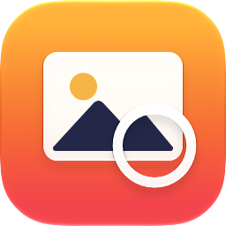
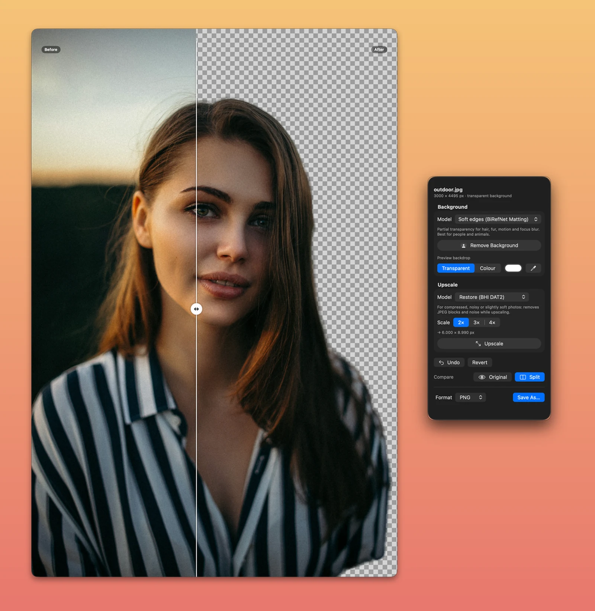

# Lightbox

A small macOS photo tool that removes backgrounds and upscales photos on-device, with open models running through
Core ML on the Apple silicon GPU and Neural Engine.



- **Drop a photo** anywhere on the borderless window (from Finder, Photos or any app), use Finder's
  Open With › Lightbox, or press ⌘O. The window takes the photo's proportions and the Tools panel opens beside it.
  Both windows drag from anywhere; their buttons appear while the cursor is over them.
- **Two steps, like layers**: *Upscale* first, then *Background*. Each keeps its result and has an eye toggle to hide or
  show it instantly; background removal runs on the upscaled image when it is visible, which keeps more hair strands.
- **Remove Background**: *Soft edges* (people, animals, hair, fur, motion and focus blur) or *Crisp edges* (products
  and objects). Preview the cutout on transparency or on any colour; the eyedropper picks one from anywhere on screen.
- **Upscale** 2×, 3× or 4×: *Restore* for JPEG and HEIC (removes compression blocks and noise), *Faithful* for RAW,
  TIFF and PNG originals, *Fast* on the Neural Engine. A *Texture* slider adds the original's own grain and skin texture
  back at the new size, so people don't turn plastic (defaults: Fast 70 %, Restore 20 %, Faithful 0 %).
- **Compare**: *Original* shows the unedited photo (`\`), *Split* puts a before/after line on the photo that you drag
  across it (`⌘\`), *100%* shows actual pixels (`⌘1`, or double-click the photo where you want to look; drag or scroll
  to move around). Both comparisons work at 100 %. Undo and Revert step back.
- **Save As** PNG, TIFF, JPEG or HEIC, keeping EXIF, GPS and IPTC metadata, or as a **layered PSD**: the subject
  with the cutout as an editable layer mask over the hidden original photo, so the mask can be refined with a brush in
  Photoshop, Affinity, Pixelmator or Photopea. Cutouts keep their transparency (JPEG, which has none, is saved on white).

Camera, lens, focal length, aperture, shutter speed and ISO are read from EXIF and tune the background removal:
shallow depth of field picks soft edges and widens the hair refinement, deep focus picks crisp edges, slow shutters
allow for motion blur, and high ISO (adjusted for sensor size) denoises what the model sees, never the saved photo.

Nothing leaves the Mac: the app is sandboxed without network access and reads only the photos you give it.

The app icon is an Icon Composer document (`Lightbox/AppIcon.icon`) in the macOS Golden Gate style: Liquid Glass
layers that the system renders, with light, dark, tinted and clear variants. Open it in Icon Composer to adjust it.

## Build

Requires macOS 26 or later on Apple silicon, Xcode 26+, [XcodeGen](https://github.com/yonaskolb/XcodeGen) and
[uv](https://github.com/astral-sh/uv) (for the one-time model conversion).

```bash
tools/build-models.sh    # once: downloads the official weights and converts them to Core ML (~1.4 GB)
scripts/release.sh
```

`build-models.sh` creates a Python 3.12 environment in `tools/.venv` (PyTorch, coremltools, spandrel, transformers),
downloads each model from its original source, converts it and writes `Lightbox/Models/*.mlpackage`; Xcode compiles
those into the app. `release.sh` generates the project, builds Release, quits a running Lightbox, installs to
`/Applications/Lightbox.app` and launches it. Pass another folder (`scripts/release.sh ~/Applications`),
`--no-launch`, or `--zip` to also write `build/Lightbox-<version>.zip` for copying to another Mac. The app is not
notarised, so on another Mac Control-click it and choose Open the first time (or run
`xattr -dr com.apple.quarantine /Applications/Lightbox.app`).

## Models

| Task | Model | Licence | Runs on | Speed (M5 Pro) |
|---|---|---|---|---|
| Background, *Soft edges* | [BiRefNet_HR-matting](https://huggingface.co/ZhengPeng7/BiRefNet_HR-matting), 2048 px | MIT | GPU | ~1 s per pass |
| Background, *Crisp edges* | [BiRefNet_HR](https://huggingface.co/ZhengPeng7/BiRefNet_HR), 2048 px | MIT | GPU | ~1 s per pass |
| Hair refinement | [ViTMatte-B](https://huggingface.co/hustvl/vitmatte-base-composition-1k), 1024 px tiles | Apache 2.0 | GPU | ~0.16 s per tile |
| Upscale, *Restore* | [4xBHI_dat2_real](https://github.com/Phhofm/models/releases/tag/4xBHI_dat2_real) | CC-BY-4.0 | GPU | ~10 s per input megapixel |
| Upscale, *Faithful* | [4xNomos2_hq_dat2](https://github.com/Phhofm/models/releases/tag/4xNomos2_hq_dat2) | CC-BY-4.0 | GPU | ~10 s per input megapixel |
| Upscale, *Fast* | [Real-ESRGAN x4plus](https://github.com/xinntao/Real-ESRGAN) | BSD-3-Clause | Neural Engine | ~2.5 s per input megapixel |

BiRefNet is the strongest open model for high-resolution subject segmentation; Bria's RMBG-2.0 shares its
architecture but is licensed for non-commercial use only, so it is not used. DAT2 transformers give the most faithful
photo detail: the BHI variant is trained on real degradations (JPEG and WebP compression, noise, blur), Nomos2-hq on
clean images. Every converted model was checked against its PyTorch original (BiRefNet IoU 0.9994, DAT2 58–59 dB
PSNR, ViTMatte within 0.05/255).

## How background removal works

A 20 MP photo takes about 3 s, in stages (`Lightbox/Engine.swift`):

1. **Whole photo at 2048 px.** BiRefNet decides what the subject is; its edges are soft but clean.
2. **Hair matting** (*Soft edges*). A trimap is built from the segmentation (subject, background, and an unknown band
   that reaches further outwards, where flyaways are) and ViTMatte computes exact partial transparency inside the band
   on native-resolution 1024 px tiles. Its result is used only where it shows strand-like texture (hair, fur): on
   smooth, out-of-focus edges such as arms and legs it leaves faint streaks of background, so stage 1 is kept there.
   Re-running BiRefNet on native-resolution tiles was tried and dropped: a tile that sees only part of a limb loses
   context and smears its edge.
3. **Clean-up.** Matting leaves a faint, smooth alpha haze beyond soft edges; alpha that is both faint and smooth is
   faded out, strand-like detail is kept, and specks away from the subject are dropped.
4. **Colour decontamination.** Edge pixels mix subject and background colour; blur-fusion foreground estimation
   (`Lightbox/ForegroundEstimator.swift`, on Accelerate) recovers the subject's own colour so no outline of the old
   background remains.

## How upscaling works

Texture retention: the AI result plus a share of the original's fine detail, enlarged with Lanczos to the new size
(`out = ai + k × (up − blur(up))`, `Engine.retainTexture`), applied when the image is composed, so moving the slider
doesn't re-run the model.

The photo is cut into 256 px tiles that overlap by 16 px; each tile is upscaled 4× and only its centre is kept, so seams
don't show. For 2× and 3× each tile is resampled with Lanczos before it is placed. Larger tiles gave no speed-up on the
GPU, and DAT2's window attention is about 150× slower on the Neural Engine than on the GPU, so the DAT2 models are
pinned to the GPU and Real-ESRGAN to the Neural Engine.

## Converting the models

- BiRefNet's decoder uses `torchvision.ops.deform_conv2d`, which Core ML lacks. `tools/convert_birefnet.py` replaces it
  with an exact equivalent built from `grid_sample` and one 1×1 convolution per kernel tap (within 7e-5 of torchvision).
  The Core ML matte is about 4× faster than PyTorch on MPS.
- ViTMatte resizes its position tables inside scripted code; at a fixed 1024 px input those are constants, so
  `tools/convert_vitmatte.py` precomputes them.
- `tools/ct_patches.py` works around a coremltools cast error on traced shape arithmetic (DAT2, BiRefNet).
- `tools/check_upscaler.py` and `tools/check_birefnet.py` compare a converted model with PyTorch and time each compute
  unit.

## Testing without clicking

Debug builds include a harness. `--selftest <photo>` runs every model on a photo headless and writes the results next
to it (`--cutout-only` skips the upscalers); `--snapshot <dir>` writes PNGs of the windows after 10 s, and with
`--demo-cutout` after removing the background of the opened photo and turning on the split view. The app is
sandboxed, so use paths inside its container:

```bash
C=~/Library/Containers/com.stormbuster.lightbox/Data/tmp; mkdir -p $C && cp photo.jpg $C/
build/Build/Products/Debug/Lightbox.app/Contents/MacOS/Lightbox --selftest $C/photo.jpg --cutout-only
```

`LIGHTBOX_NOREFINE=1` returns the stage-1 matte as is, `LIGHTBOX_NOHAIR=1` skips the hair matting and
`LIGHTBOX_RAW=1` skips the clean-up, for comparisons. The self-test also writes the layered PSD.

## Licence

Lightbox is MIT licensed (see `LICENSE`). The models keep their own licences, below.

## Credits

- BiRefNet by Peng Zheng et al., MIT.
- ViTMatte by Jingfeng Yao et al. (hustvl), Apache 2.0.
- 4xBHI_dat2_real and 4xNomos2_hq_dat2 by Philip Hofmann, CC-BY-4.0.
- Real-ESRGAN by Xintao Wang et al., BSD-3-Clause.
- Foreground estimation after Forest et al., "Approximate Fast Foreground Colour Estimation" (ICIP 2021), as in
  BiRefNet's `refine_foreground`.
- The PSD writer follows Adobe's [Photoshop File Format Specification](https://www.adobe.com/devnet-apps/photoshop/fileformatashtml/).
- The borderless windows follow [stormbuster/borderless](https://github.com/stormbuster/borderless).
- The screenshot's photo is from [Unsplash](https://unsplash.com) (Unsplash License).

The model weights are not in this repository; `tools/build-models.sh` downloads them from their original sources. If
you distribute a built Lightbox.app, it contains the converted models, so include their licences and credit the
CC-BY-4.0 upscalers as above.
